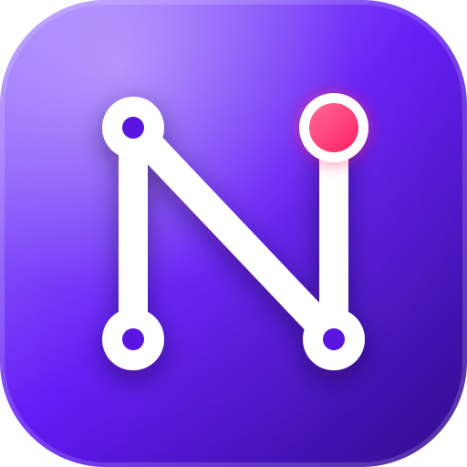
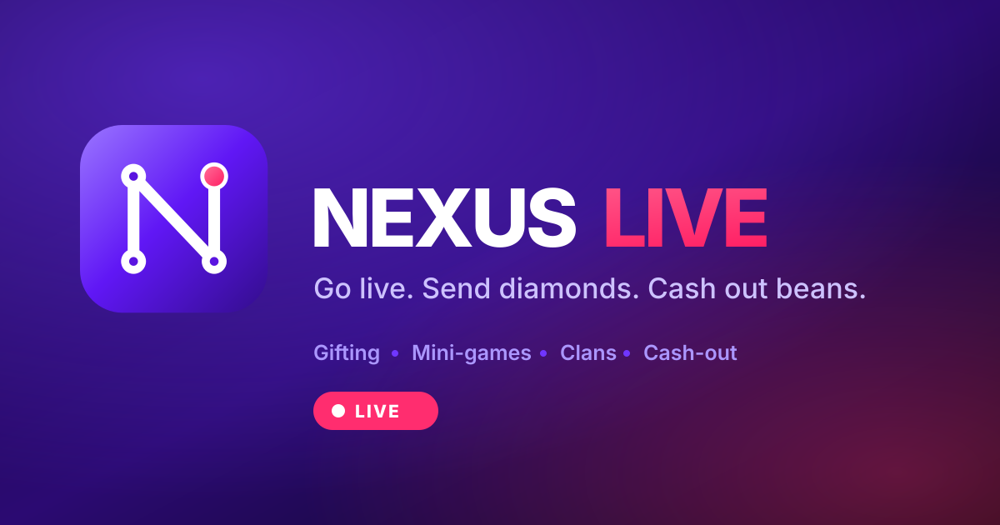

<p align="center">
  
</p>

<h1 align="center">Nexus Live</h1>

<p align="center">
  Go live. Send diamonds. Cash out beans.<br>
  <sub>A live-streaming social PWA — gifting, mini-games, clans and a single-owner admin portal.</sub>
</p>

---

## What this is

A Bigo-Live-style streaming app built as an installable PWA. Viewers buy
**diamonds** and spend them on gifts and mini-games. Hosts receive **beans**,
the only balance that converts back to money. One owner account runs the
platform from a Master Admin portal.

The two balances never mix, and that rule is enforced in one place — see
[`docs/SPEC.md`](docs/SPEC.md) §1.

## Running it

Requires Node 20.11+ and a PostgreSQL 14+ you can reach.

```bash
cp .env.example .env     # then set JWT_SECRET and the MASTER_ADMIN_* values
npm install
docker compose up -d     # Postgres on 5432, Redis on 6379
npm run db:push
npm run db:seed          # creates the owner, plus demo data outside production
npm run dev
```

Open http://localhost:3000. The seed also creates five demo accounts
(`aria`, `kenji`, `mila`, `dev`, `zuri`), password `demo1234`, two of them live.

Sign in as the address in `MASTER_ADMIN_EMAIL` to reach `/admin`.

### Checks

```bash
npm test        # economy rules — rates, odds, cash-out maths, levels
npm run typecheck
npm run lint
npm run build
```

## How it is put together

| | |
|---|---|
| **Framework** | Next.js 15, App Router, React 19, TypeScript strict |
| **Styling** | Tailwind 3, dark-first, mobile-first |
| **Data** | Prisma 6 + PostgreSQL |
| **Auth** | `jose` JWT in an httpOnly cookie, bcryptjs at cost 12 |
| **Validation** | zod on every request body |
| **Tests** | vitest over the pure economy module |

### The parts worth knowing about

- **`src/lib/economy.ts`** — every rate, price, odd and formula in the product,
  pure and dependency-free, so the whole economy is unit-testable without a
  database. Nothing else is allowed to hardcode a number.
- **`src/lib/wallet.ts`** — the only door money moves through. `adjustWallet()`
  locks the user row, refuses to push a balance negative, writes the ledger
  entry, and updates the lifetime counters, all in the caller's transaction.
  `lockUsers()` sorts ids before locking so two people gifting each other
  cannot deadlock.
- **Three gates on the owner account** — edge middleware on the JWT, a fresh
  database check in the portal layout, and `requireMasterAdmin()` inside every
  admin handler. The role-change schema has no `MASTER_ADMIN` member, so no
  request body can reach it.
- **`public/sw.js`** — caches the shell, and never `/api`, `/wallet` or
  `/admin`. Balances have to be live.

## The logo

An **N** drawn as a node graph, with the top-right node as the live indicator.
`public/logo.svg` is the source; `npm run icons` renders every PWA icon, the
maskable set, the favicon and the social card from it.

<p align="center">
  
</p>

Full brand notes in [`docs/BRAND.md`](docs/BRAND.md).

## Not built yet

Video transport (LiveKit), payments, Redis, transactional email and media
uploads. Each has a phase with concrete steps in
[`docs/BUILD_PLAN.md`](docs/BUILD_PLAN.md).
